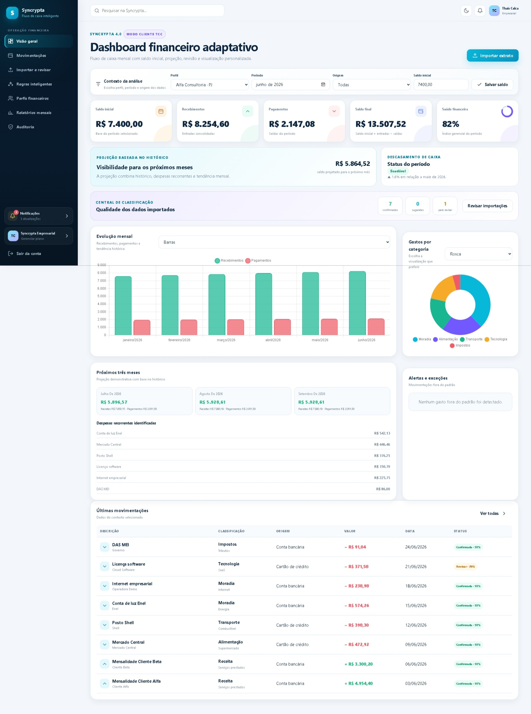
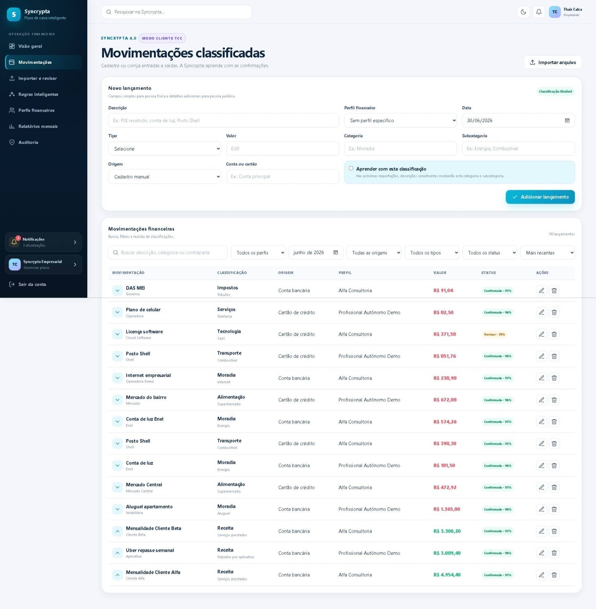
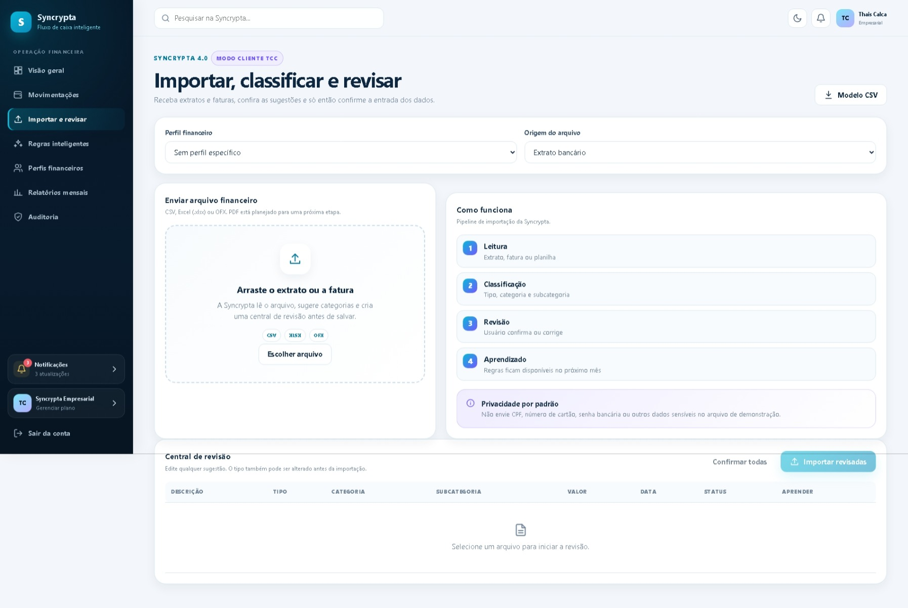
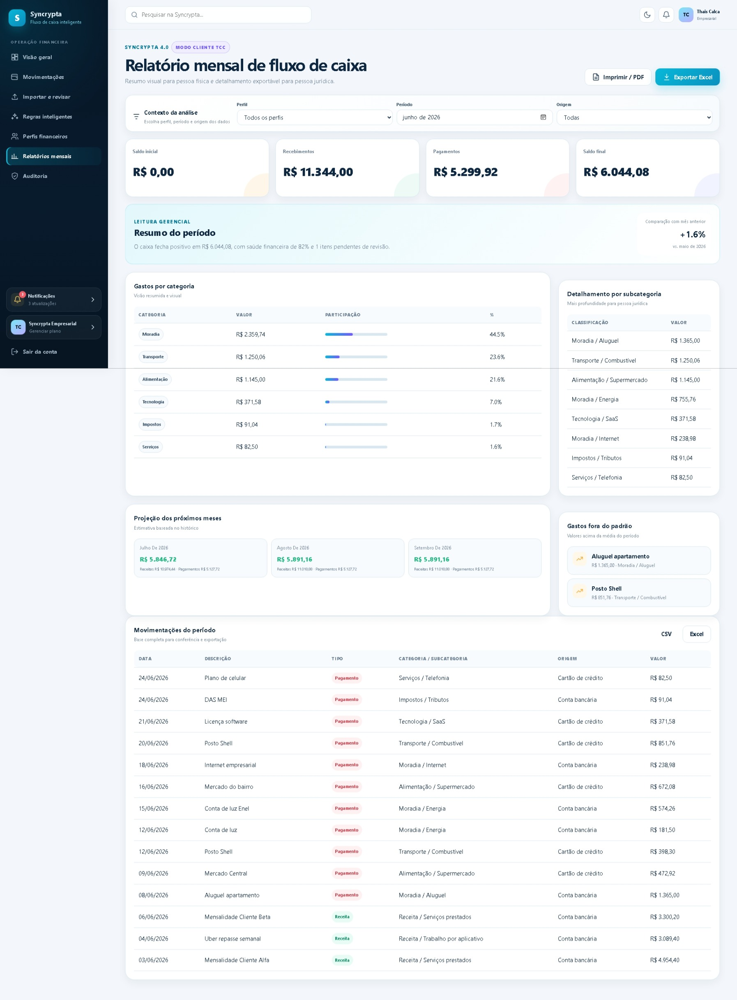
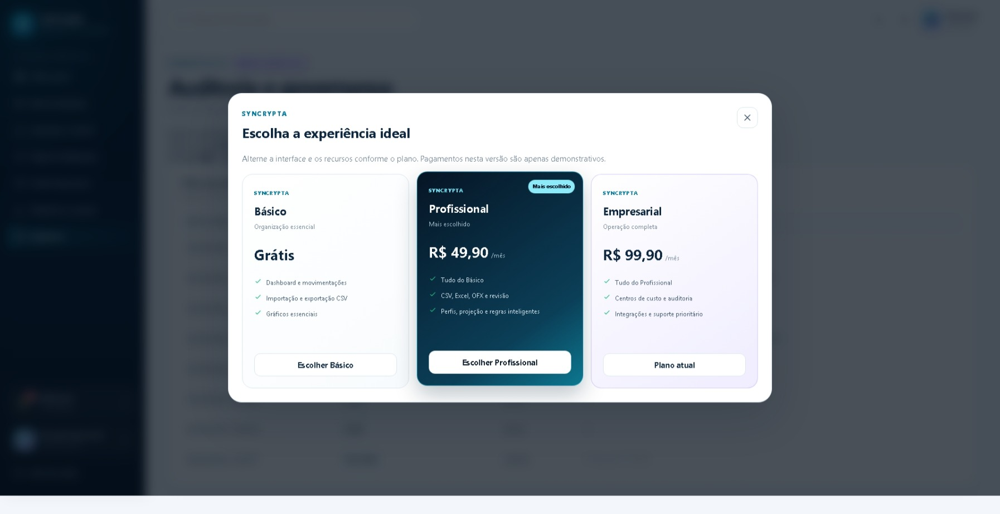

# Syncrypta 4.14 · Conta de exemplo da Thaís e importação mais segura

- **Conta de exemplo da Thaís:** dê dois cliques em `3_CONTA_EXEMPLO_THAIS.bat`, ou rode `node conta-exemplo.js` na pasta `backend`, com o backend desligado. O script cria ou conserta a conta `thais.demo@syncrypta.local` / `Syncrypta@2026` (master, com dados fictícios) **sem apagar nada**. O `1_PREPARAR_DEMO.bat` também passou a fazer isso; antes ele só criava a visita.
- **A importação não abre mais com dados falsos:** antes a página já vinha com 3 linhas inventadas fingindo um arquivo, e quem clicava em Importar salvava esses dados na conta. Agora há o botão **"Usar extrato de exemplo"**, que passa o arquivo de teste pelo mesmo caminho de um arquivo real.
- **Extrato repetido não duplica:** na revisão, o que já está na Syncrypta (mesma data, valor e descrição) aparece como "Já está na Syncrypta" e não entra de novo, a menos que você marque "importar mesmo assim".
- **O balão de Ajuda não cobre mais** o botão Importar nem o fim das páginas.

---

# Syncrypta 4.13 · Configurações, administração de usuários e regras corrigidas

- **Nova página Configurações** (menu lateral e menu do perfil), com cinco abas:
  - **Conta:** nome que aparece no site, plano e forma de login.
  - **Aparência:** texto maior, modo compacto, cor de destaque ciano ou roxo, animações reduzidas.
  - **Uso:** página que abre depois do login, gráfico padrão da Visão geral, mostrar ou esconder o balão de ajuda, rever o tour.
  - **Segurança:** trocar a senha.
  - **Usuários (só a conta master):** tabela "quem pode fazer o quê", lista de contas, troca de plano e suspensão ou reativação de acesso. Conta suspensa não entra mais, e o acesso que estava aberto deixa de valer.
- **As preferências ficam salvas na conta:** valem em qualquer computador. Na visita e no acesso de cliente, ficam só no navegador.
- **Regras inteligentes corrigidas:** a palavra precisa aparecer inteira ("posto" não pega mais "composto"); regra desativada não é usada; regra de pagamento não classifica receita. Também há um quadro novo **"Testar as regras"**.
- **Novo balão "Ajuda":** ícone de conversa com o ponto de "online".
- **Correção visual:** botões secundários ficavam brancos e com o texto sumido ao passar o mouse.
- **Testes novos:** `node tests/configuracoes-smoke.js` e `node tests/regras-smoke.js`.

---

# Syncrypta 4.12 · Auditoria funcionando

- **Correção principal:** a auditoria exigia a conta master. Quem assinava o Empresarial recebia erro 403 e a tela ficava zerada, sem explicação. Agora ela segue o plano (Empresarial ou conta master), e cada conta vê só os próprios registros.
- **Contadores corrigidos:** "Alterações críticas" e "Exportações" procuravam nomes de ação que nunca eram gravados, por isso ficavam sempre em 0. Agora contam exclusões, reclassificações em lote, trocas de plano e acessos criados, e as exportações de relatório em CSV ou Excel, que passaram a ser anotadas.
- **Tela mais clara:** as ações e as entidades aparecem em português ("Importação", "Movimentação"…). Se a auditoria não carregar, a tabela mostra o motivo.
- **Demonstração com histórico:** `npm run seed` (ou `1_PREPARAR_DEMO.bat`) cria uma trilha fictícia de ações. Assim a tela não abre vazia na apresentação.
- Teste novo: `node tests/auditoria-smoke.js`.

---

# Syncrypta 4.11 · CNPJ mais confiável e conversa na Ajuda

- **CNPJ com serviço reserva:** se a BrasilAPI falhar, demorar ou bloquear, o backend tenta a **Minha Receita** e depois o **CNPJ.ws**. A lógica foi para `backend/cnpj.js`. O terminal do servidor mostra o que cada serviço respondeu.
- **Diagnóstico do CNPJ:** na pasta `backend`, rode `node testar-cnpj.js 19131243000197` para ver se o seu computador ou a sua rede consegue falar com cada serviço.
- **Mensagens de erro mais claras no site:** "o backend não está ligado" e "o backend ainda está na versão antiga, reinicie".
- **Conversa na página Ajuda:** a seção "Pergunte do seu jeito" traz o assistente aberto dentro da página. Com a IA ligada (chave no `.env`), a conversa é livre sobre o site e sobre finanças de autônomos e pequenos negócios.
- **IA menos travada:** agora ela também explica conceitos gerais (fluxo de caixa, MEI, DAS, pró-labore, precificação). Para o caso específico de imposto, continua indicando o contador.
- **Planos:** a **revisão da importação** passa a fazer parte do Básico, porque é o fluxo principal do produto. Os textos dos planos foram acertados.

---

# Syncrypta 4.10 · Assistente com IA

- O balão **Ajuda** agora pode responder com **IA** (Google Gemini ou Anthropic Claude), usando como base a Central de Ajuda do site. Assim ele conversa de forma natural e não inventa funções.
- **Para ligar:** copie `backend/.env.exemplo` para `backend/.env`, coloque **uma** chave (`GEMINI_API_KEY` ou `ANTHROPIC_API_KEY`) e reinicie o backend. No Render, preencha `GEMINI_API_KEY` em Environment.
- **Sem chave, nada quebra:** o assistente continua respondendo pela Central de Ajuda, como na 4.9.
- **O que nunca vai para a IA:** a chave (fica só no servidor), os números do seu caixa e os dados de CNPJ (essas respostas o próprio site calcula, sem IA). CPF, cartão e outros números longos são apagados da pergunta antes do envio.
- **Limites contra custo surpresa:** 20 perguntas a cada 15 minutos por pessoa e 300 por dia no site todo (dá para mudar no `.env`).
- Explicação para a banca em **[COMO_FUNCIONA_4_9.md](COMO_FUNCIONA_4_9.md)**, parte 6. Teste novo: `node tests/ia-smoke.js` (usa uma IA falsa, sem gastar nada).

---

# Syncrypta 4.9 · Ajuda, tour, campanha, CNPJ e assistente

- **Consulta de CNPJ (API):** com só o CNPJ, a Syncrypta preenche nome, tipo e segmento em **Perfis financeiros** e o campo "Quem recebeu ou pagou" em **Movimentações** (perfis PJ). Quem consulta a **BrasilAPI** (dados públicos da Receita Federal) é o backend, na rota `GET /api/cnpj/:cnpj`. Ela confere os dígitos do CNPJ, exige login, guarda o resultado por 24 h e devolve só nome, atividade, cidade, situação, abertura e porte. Sócios, e-mails e telefones ficam de fora, e o CNPJ não é salvo.
- **Tour de primeiro acesso:** conta nova (plano Básico, sem dados) vê um passo a passo na primeira visita à Visão geral. Dá para rever pelo menu do perfil, pela Ajuda ou abrindo `dashboard.html?tour=1`.
- **Central de Ajuda (`ajuda.html`):** perguntas frequentes com busca, incluindo as dúvidas dos Stories da campanha. Cada pergunta tem endereço próprio (ex.: `ajuda.html#pix-pessoal`), bom para o link dos Stories.
- **Seção da campanha na página inicial:** os dois vídeos verticais (feitos com IA) e o botão "Teste o plano grátis".
- **Assistente (helperbot):** balão "Ajuda" em todas as páginas. Responde com base na Central de Ajuda (não usa IA), busca CNPJ e, logado, diz quanto entrou, saiu e sobrou no mês.
- **Correção:** apóstrofos apareciam como "a99;" em nomes e textos (o `escaparHtml` trocava `'` por um código errado).
- Explicação de cada parte, para a banca: **[COMO_FUNCIONA_4_9.md](COMO_FUNCIONA_4_9.md)**. Teste novo: `node tests/cnpj-smoke.js`.

---

# Syncrypta 4.8.3 · Pronta para publicar online

- O site pode ser publicado **de graça no Render**, em um endereço público como `https://syncrypta.onrender.com`. O passo a passo está em **[PUBLICAR_ONLINE.md](PUBLICAR_ONLINE.md)**, e a configuração em `render.yaml`.
- O servidor agora entrega as páginas e a API juntos; a pasta `backend` (dados e `.env`) continua protegida.
- Online, os dados são sempre os fictícios de demonstração, recriados a cada reinício. Login da demonstração: `thais.demo@syncrypta.local` / `Syncrypta@2026`.
- No computador nada muda: `npm.cmd start` e Live Server, ou direto em `http://localhost:3000`.

---

# Syncrypta 4.8.2 · Espaçamento e acabamento

- Movimentações: os três cards de resumo ficam sempre lado a lado (sem espaço vazio) e os filtros quebram em linhas em vez de cortar o texto.
- Auditoria: mais espaço entre os cards e a tabela; a coluna "Detalhes" mostrava `[object Object]` e agora mostra o conteúdo legível.
- Visão geral: "Próximos três meses" e "Alertas e exceções" alinhados; os três meses sempre na mesma linha, com receitas e pagamentos em linhas separadas.
- Página inicial e login: o logo e os blocos ganharam respiro e o balão "Classificação automática" não cobre mais o conteúdo.

---

# Syncrypta 4.8.1 · Paleta oficial e filtro de categorias

- **Paleta oficial aplicada em todo o site:** Ciano principal `#00D1FF`, Azul secundário `#007BFF`, Roxo destaque `#7B3DFF`, Roxo claro `#B14CFF`, Branco `#FFFFFF`, Cinza médio `#8A9BB0`, Cinza escuro `#1E2A3A`, Preto `#0B0F14` e Azul escuro `#0A2240`. Entradas/valores positivos em ciano; saídas/pagamentos em roxo claro. As cores ficam como variáveis no início de `ajustes-finais.css` (`--sc-ciano`, `--sc-azul`…).
- **Biblioteca de classificação:** novo filtro "Todas as categorias", ao lado da busca, mostrando quantas regras cada categoria tem.
- `backend/package-lock.json` refeito (o anterior pedia uma versão inexistente de `lodash.includes` e fazia o `npm install` falhar).

---

# Syncrypta 4.8.0 · Correções de funcionamento, layout e paleta azul

**Correção principal:** a Visão geral e as notificações travavam (erro `Cannot read properties of undefined (reading 'receitas')` no terminal) sempre que algum dos últimos 6 meses não tinha lançamentos. Por isso as movimentações novas não apareciam no painel e os filtros pareciam não responder. Meses vazios agora contam como zero (`backend/server.js`, função `resumoDashboard`).

**Outras mudanças**
- Regras inteligentes organizadas por categoria: o título do cartão é a subcategoria, a palavra-chave aparece como "Quando a descrição tiver…", e o formulário começa pela categoria (com sugestões).
- Gráficos sem dados ficam recolhidos, com um aviso curto, em vez de um bloco vazio.
- Valores dos cards não quebram mais em duas linhas; tabelas e nomes longos não cortam; no celular, a lista de movimentações vira cartões e os filtros ficam em grade.
- Paleta azul radiante: vermelhos viraram rosa-violeta (saídas/pagamentos) e laranjas/amarelos viraram azul-celeste (atenção). Botões principais com degradê ciano → azul → anil.
- Novo ícone quadrado do logo (`imagens/logo-icone.png`) no menu e na aba do navegador.
- Os ajustes visuais ficam em `ajustes-finais.css`, carregado por último em todas as páginas.

**Para atualizar sem perder dados:** este pacote não traz `backend/.env` nem os arquivos de dados (`usuarios.json`, `movimentacoes.json`, `clientes.json`, `regras.json`, `saldos.json`, `pagamentos.json`, `auditoria.json`). Copie os arquivos do pacote por cima da sua pasta atual (substituindo), com o backend parado, e rode `npm start` de novo. Seus dados e seu `.env` continuam como estão. Em uma instalação nova, use `1_PREPARAR_DEMO.bat` para criar os dados de demonstração.

---

# Syncrypta 4.7.2 · Identidade visual e experiência responsiva

Esta atualização substitui o ícone “S” pelo novo logo fornecido pelo grupo em todas as páginas. A marca completa aparece na apresentação e nas telas de acesso. A entrada ganhou hierarquia visual, navegação para celular e uma apresentação mais clara do produto; o painel ganhou indicadores, cabeçalhos e tabelas mais legíveis, inclusive em telas pequenas. A paleta original foi mantida em `visual-refresh.css`.

**Para atualizar sem perder seu login Google e seus dados:** descompacte em outra pasta, copie `backend/.env` e os JSON de dados da instalação anterior com o backend parado. O `firebase-config.js` já acompanha esta entrega; confirme seus valores ao atualizar. Não rode `npm run seed` sobre dados existentes. As alterações desta edição são apenas na interface; a API continua na versão 4.7.1. Consulte [COMO_ABRIR_E_ATUALIZAR.md](COMO_ABRIR_E_ATUALIZAR.md) para os detalhes.

---

# Syncrypta 4.7.1 · Cadastro com Google e feedbacks da Taís

Abra [COMO_ABRIR_E_ATUALIZAR.md](COMO_ABRIR_E_ATUALIZAR.md) para instalar, comparar Básico/Profissional/Empresarial e atualizar uma instalação anterior sem apagar seus dados. A visita pública usa dados fictícios separados da conta master e é somente leitura.

Para usar o botão **Continuar com Google** com a janela de escolha de conta, como no exemplo enviado, siga [CONFIGURAR_FIREBASE_GOOGLE.md](CONFIGURAR_FIREBASE_GOOGLE.md). A configuração Firebase fica em `firebase-config.js` e `FIREBASE_PROJECT_ID`; o backend confirma a assinatura e a identidade Google antes de criar uma sessão Syncrypta. Sem Firebase configurado, a integração Google OAuth anterior continua disponível.

Esta versão inclui os recursos financeiros anteriores e o login Google configurável: uma conta nova recebe um plano Básico vazio automaticamente. A Taís precisa configurar o e-mail real, entrar com uma senha privada Syncrypta e vincular seu Google antes de usar as duas formas de acesso ao mesmo master. Depois de `npm.cmd install` no backend, execute `node tests/smoke.js`, `node tests/google-smoke.js` e `node tests/firebase-smoke.js` para verificar os fluxos simulados.

Esta edição mantém as cores originais. O menu do perfil mostra a saída e, somente para contas sem acesso total, a opção de planos; o botão de tema fica na barra superior, ao lado do sino. As notificações são calculadas pela API para cada contexto autorizado. O painel usa indicadores reais, gráficos interativos e detalhes por mês e categoria.

---

# Syncrypta 4.7.1 · Interface e demonstração

**Contabilidade inteligente. Segurança real.**

A **Syncrypta** é uma plataforma acadêmica de controle inteligente de fluxo de caixa desenvolvida para o TCC da **FIAP School**, a partir do desafio apresentado pela profissional de contabilidade **Thais Calca**.

A proposta não é substituir um ERP, um sistema contábil completo ou o Power BI. A Syncrypta atua em uma etapa anterior e essencial: receber dados financeiros, organizar movimentações, classificar lançamentos, permitir correções e transformar essas informações em uma visão mensal simples, visual e útil para a tomada de decisão.

> **Projeto demonstrativo:** nenhuma cobrança real é realizada, nenhuma conta bancária é conectada e todos os dados utilizados na apresentação são fictícios.

---

## Visão geral da solução

```text
Extrato bancário, fatura ou planilha
↓
Leitura e validação dos lançamentos
↓
Separação entre recebimentos e pagamentos
↓
Classificação por categoria e subcategoria
↓
Central de revisão do usuário
↓
Correção e aprendizado de regras personalizadas
↓
Dashboard e relatório mensal de fluxo de caixa
```

A plataforma foi desenvolvida para atender diferentes perfis:

- **Pessoa física:** experiência mais simples, visual e acessível pelo celular.
- **Pessoa jurídica:** maior detalhamento, filtros, centros de custo, contas, classificações e exportações.

---

## Imagens do sistema

As capturas abaixo pertencem à versão visual anterior. Abra as páginas HTML para ver a identidade desta edição.

### Dashboard



---

### Movimentações



---

### Importação, classificação e revisão



---

### Relatório mensal de fluxo de caixa



---

### Planos da plataforma



---

## Funcionalidades principais

### Interface e experiência

- Landing page premium apresentando a solução;
- Login e cadastro redesenhados;
- Tema claro e escuro;
- Sidebar moderna e responsiva;
- Interface adaptada para computador, tablet e celular;
- Conta especial para demonstração do TCC;
- Alteração da interface conforme o plano selecionado.

### Dashboard financeiro

O dashboard apresenta:

- saldo inicial;
- total de recebimentos;
- total de pagamentos;
- saldo final;
- saúde financeira;
- descasamento de caixa;
- comparação com o mês anterior;
- projeção dos próximos três meses;
- despesas recorrentes;
- gastos fora do padrão;
- qualidade dos dados importados;
- últimas movimentações;
- gráficos mensais e por categoria;
- escolha entre gráficos de barras, linhas, pizza e rosca.

A fórmula principal utilizada é:

```text
Saldo final = saldo inicial + recebimentos − pagamentos
```

### Perfis financeiros

A plataforma permite criar perfis para diferentes contextos, como:

- pessoa física;
- profissional autônomo;
- empresa;
- cliente de escritório contábil;
- unidade ou centro de custo.

Os filtros podem considerar:

- perfil financeiro;
- mês;
- origem;
- conta ou cartão;
- tipo da movimentação;
- status da classificação.

### Movimentações

As movimentações possuem:

- descrição;
- tipo: receita ou pagamento;
- valor;
- data;
- categoria;
- subcategoria;
- origem;
- conta ou cartão;
- contraparte;
- centro de custo;
- natureza do gasto;
- perfil financeiro;
- nível de confiança da classificação;
- status de confirmação ou revisão.

Também estão disponíveis:

- cadastro manual;
- busca;
- filtros;
- ordenação;
- edição;
- exclusão;
- aprendizado com a classificação escolhida.

### Importação financeira

A Syncrypta permite importar:

- arquivos CSV;
- planilhas Excel `.xlsx`;
- arquivos OFX.

Durante a importação, o sistema:

1. lê o arquivo;
2. identifica receitas e pagamentos;
3. sugere categorias e subcategorias;
4. calcula um nível de confiança;
5. envia itens incertos para revisão;
6. permite corrigir o tipo e a classificação;
7. salva regras para lançamentos semelhantes.

### Central de revisão

Antes de confirmar uma importação, o usuário pode:

- alterar o tipo da movimentação;
- alterar a categoria;
- alterar a subcategoria;
- confirmar sugestões;
- identificar itens não classificados;
- escolher se a correção deverá gerar uma nova regra.

### Regras inteligentes

Exemplos de regras:

```text
Contém "Shell"
→ Transporte / Combustível

Contém "Enel"
→ Moradia / Energia

Contém "Mercado"
→ Alimentação / Supermercado
```

Quando o usuário corrige uma classificação e permite o aprendizado, a regra fica disponível para futuras importações.

> O aprendizado demonstrado é baseado em regras e histórico de correções. Não utiliza um modelo externo de inteligência artificial treinado.

### Relatórios mensais

Os relatórios apresentam:

- saldo inicial;
- recebimentos;
- pagamentos;
- saldo final;
- resumo gerencial;
- comparação com o mês anterior;
- gastos por categoria;
- gastos por subcategoria;
- gastos fora do padrão;
- projeção dos próximos meses;
- lista completa das movimentações;
- exportação CSV;
- exportação Excel;
- impressão e geração de PDF pelo navegador.

### Gestão e controle

- Gestão de perfis financeiros;
- Auditoria de ações;
- Histórico de alterações;
- Notificações inteligentes;
- Alertas diferentes para pessoa física e pessoa jurídica;
- Controle de recursos por plano;
- Checkout demonstrativo;
- Ativação demonstrativa de planos.

---

## Planos

| Recurso | Básico | Profissional | Empresarial |
|---|:---:|:---:|:---:|
| Dashboard e movimentações | Sim | Sim | Sim |
| Importação e exportação CSV | Sim | Sim | Sim |
| Excel e OFX | Não | Sim | Sim |
| Central de revisão | Não | Sim | Sim |
| Regras inteligentes | Não | Sim | Sim |
| Projeção financeira | Não | Sim | Sim |
| Perfis financeiros | Não | Sim | Sim |
| Centros de custo | Não | Não | Sim |
| Auditoria avançada | Não | Não | Sim |
| Recursos empresariais | Não | Não | Sim |

Os pagamentos são apenas demonstrativos e não geram cobranças reais.

---

## Formatos de entrada

| Formato | Situação |
|---|---|
| CSV | Funcional |
| Excel `.xlsx` | Funcional pela primeira aba |
| OFX | Funcional para lançamentos bancários básicos |
| PDF | Planejado para uma etapa futura |

A pasta `arquivos_teste` contém exemplos prontos para apresentação.

---

## Contas demonstrativas

### Cliente TCC

```text
E-mail: thais.demo@syncrypta.local
Senha: Syncrypta@2026
```

Essa conta:

- começa no plano Empresarial;
- possui dados financeiros fictícios;
- possui perfis de pessoa física e jurídica;
- possui regras de classificação;
- possui saldos iniciais;
- possui registros de auditoria;
- pode alternar livremente entre os planos;
- não precisa realizar pagamento;
- muda a interface conforme o plano selecionado.

### Usuário comum

```text
E-mail: demo@syncrypta.local
Senha: Demo@2026
```

Essa conta:

- começa no plano Básico;
- permite testar as limitações dos planos;
- permite acessar o checkout demonstrativo;
- pode ativar planos por PIX ou cartão simulados.

> O telefone pessoal informado durante o desenvolvimento não foi incluído no código, nos dados de teste ou nas credenciais.

---

## Tecnologias utilizadas

### Front-end

- HTML5;
- CSS3;
- JavaScript;
- Chart.js;
- interface responsiva;
- Local Storage e Session Storage para controle da sessão no navegador.

### Back-end

- Node.js;
- Express;
- bcryptjs;
- JSON Web Token;
- Helmet;
- express-rate-limit;
- CORS;
- dotenv;
- armazenamento demonstrativo em arquivos JSON.

### Ferramentas

- Visual Studio Code;
- Live Server;
- Git;
- GitHub;
- npm.

---

## Pré-requisitos

Para executar o projeto, é necessário instalar:

- Node.js LTS;
- npm;
- Visual Studio Code;
- extensão Live Server.

---

## Como executar

### 1. Baixar o projeto

Clique em:

```text
Code → Download ZIP
```

Extraia o arquivo e abra a pasta no Visual Studio Code.

### 2. Abrir o terminal na pasta do backend

```bash
cd backend
```

### 3. Instalar as dependências

```bash
npm install --no-audit --no-fund
```

No Windows PowerShell, caso o comando `npm` seja bloqueado pela política de execução, use:

```powershell
npm.cmd install --no-audit --no-fund
```

### 4. Criar os dados demonstrativos

```bash
npm run seed
```

No PowerShell:

```powershell
npm.cmd run seed
```

Esse comando recria os usuários, movimentações, perfis, regras, saldos e registros demonstrativos.

### 5. Iniciar o backend

```bash
npm start
```

No PowerShell:

```powershell
npm.cmd start
```

O terminal deverá mostrar:

```text
Syncrypta 4.0 disponível em http://localhost:3000
```

Mantenha esse terminal aberto enquanto utilizar o sistema.

### 6. Abrir o site

No Visual Studio Code:

1. localize o arquivo `index.html`;
2. clique com o botão direito;
3. selecione **Open with Live Server**.

O site será aberto em um endereço semelhante a:

```text
http://127.0.0.1:5500/index.html
```

### Próximas execuções

Depois que as dependências e os dados já tiverem sido criados, basta executar:

```powershell
cd backend
npm.cmd start
```

Depois abra novamente o `index.html` com o Live Server.

---

## Atalhos para Windows

O projeto também possui:

```text
1_PREPARAR_DEMO.bat
2_INICIAR_BACKEND.bat
```

- `1_PREPARAR_DEMO.bat`: instala as dependências e cria os dados demonstrativos;
- `2_INICIAR_BACKEND.bat`: inicia o servidor.

---

## Arquivos de teste

```text
arquivos_teste/
├── extrato_teste.csv
├── extrato_teste.xlsx
├── extrato_teste.ofx
└── LEIA-ME.txt
```

Esses arquivos podem ser utilizados na página **Importar e revisar**.

---

## Estrutura do projeto

```text
Syncrypta-TCC-Criacao-Site/
├── backend/
│   ├── config/
│   │   └── planos.js
│   ├── auditoria.json
│   ├── clientes.json
│   ├── movimentacoes.json
│   ├── pagamentos.json
│   ├── regras.json
│   ├── saldos.json
│   ├── usuarios.json
│   ├── .env.example
│   ├── package.json
│   ├── package-lock.json
│   ├── seed-demo.js
│   └── server.js
├── arquivos_teste/
│   ├── extrato_teste.csv
│   ├── extrato_teste.xlsx
│   ├── extrato_teste.ofx
│   └── LEIA-ME.txt
├── imagens/
│   ├── dashboard.jpeg
│   ├── movimentacoes.jpeg
│   ├── importacao.jpeg
│   ├── relatorios.jpeg
│   └── planos.jpeg
├── vendor/
│   └── chart.umd.js
├── index.html
├── login.html
├── cadastro.html
├── dashboard.html
├── movimentacoes.html
├── importacao.html
├── regras.html
├── clientes.html
├── relatorios.html
├── auditoria.html
├── checkout.html
├── script.js
├── style.css
├── interface-upgrade.css
├── CHANGELOG_V4.md
├── GUIA_DE_INSTALACAO_E_APRESENTACAO.md
├── VERSION.txt
└── README.md
```

---

## Privacidade e segurança

A Syncrypta evita o cadastro de informações como:

- CPF;
- CNPJ;
- número completo do cartão;
- CVV;
- senha bancária;
- credenciais financeiras reais.

O projeto demonstra:

- hash de senhas com bcrypt;
- autenticação JWT;
- rotas protegidas;
- limite de tentativas de login;
- cabeçalhos de segurança com Helmet;
- separação de informações por usuário;
- controle de recursos por plano;
- auditoria de operações;
- arquivo `.env.example` sem segredo real;
- dados fictícios para demonstração.

Para uma versão de produção ainda seriam necessários:

- banco de dados gerenciado;
- HTTPS;
- backups;
- recuperação de conta;
- consentimento;
- política de privacidade;
- adequação completa à LGPD;
- provedor real de pagamentos;
- testes automatizados;
- testes de segurança;
- monitoramento e logs em servidor.

---

## Limitações conhecidas

- arquivos PDF ainda não são interpretados automaticamente;
- o leitor de Excel trabalha com a primeira aba;
- o parser OFX cobre os campos mais comuns;
- pagamentos são simulados;
- nenhuma integração bancária real é realizada;
- projeções são demonstrativas e baseadas em médias e recorrência;
- não existe um modelo de inteligência artificial externo treinado;
- o armazenamento em JSON é adequado para apresentação, mas não para produção.

---

## Integrantes

- **Tales Oliveira Campos** — RM 13222
- **Kenny Koixun Navarrete Yang** — RM 14356
- **Pedro Henrique Tourino Marconni** — RM 16082
- **Lucas Rezende Rino** — RM 16444
- **Vinicius Ettore Almeida Souza** — RM 16320
- **Henrique de Paula Corredor** — RM 16365

---

## Status do projeto

**Syncrypta 4.0.2 Premium Final**

Projeto preparado para:

- testes;
- demonstração;
- apresentação do TCC;
- refinamentos finais até outubro de 2026.

---

## Aviso acadêmico

Este projeto foi desenvolvido exclusivamente para fins educacionais e demonstrativos no contexto do TCC da FIAP School.
